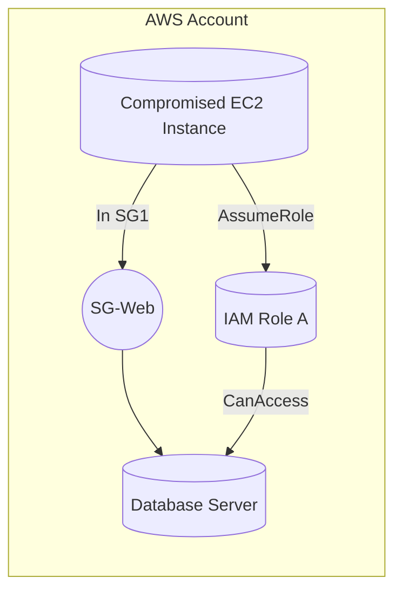

# Cloud Attack-Path Analysis and Blast-Radius Dashboard Using Prisma Cloud Data

## Executive Summary

Modern enterprises increasingly operate across **multi-cloud** environments (AWS, GCP, Azure, etc.), creating complex webs of resources and identities. Traditional point-in-time scanners and alerts often generate thousands of siloed warnings without showing how these issues connect.  An attacker who breaches one asset can often pivot through identity and network relationships to reach critical systems – a problem encapsulated by the concept of *blast radius*.  The Cloud Security Alliance defines blast radius as “every asset, identity, dataset, and downstream service an attacker can touch from a single point of compromise”.  In short, it’s not enough to find vulnerabilities; we must see **how vulnerabilities link together** across cloud accounts to assess potential impact and prioritize defenses.

This report explores how to build a rigorous analytical tool — a dashboard and backend system — that uses data from **Prisma Cloud** (Palo Alto Networks) to compute end-to-end cloud *attack paths* and measure blast radius across cloud accounts.  We cover the problem and value proposition, survey relevant research and industry solutions, detail graph-based algorithms (from simple graph traversal to probabilistic and heuristic methods), enumerate required data (resource inventory, IAM trusts, network topology, etc.), and outline a graph schema to represent the cloud environment.  We then propose a prototype system architecture (including a graph database and processing pipeline), design concepts for an interactive visualization (attack-path explorer with risk scoring and mitigation guidance), and methods for evaluation (metrics and red-team testing).  Tables compare common algorithms, graph database options, and visualization libraries.  Mermaid diagrams illustrate the system architecture and an example attack path.  Throughout, we cite academic and vendor sources (e.g. Wiz, Prowler, Orca, CSA) to ground our analysis.  In short, our dashboard would turn disparate cloud data into a unified **attack graph**, enabling security teams to quickly identify the most critical paths an attacker could exploit and thus dramatically improve risk prioritization and incident response.

## Problem Statement and Value Proposition

The **blast-radius problem** in cloud security is acute: a single misconfiguration or compromised low-privilege identity can have far-reaching impact, especially in interconnected cloud accounts.  Industry studies and expert blogs highlight that cloud security teams struggle to understand lateral movement across cloud services.  For example, the CSA notes that breach response is often hindered by lack of visibility into an environment’s full attack surface; defenders need to know “what attackers could touch” from a given compromise.  A blast-radius dashboard directly addresses this by mapping *all* possible paths from any entry point to high-value assets.

**Key benefits** include:

- **Prioritized Threat Reduction**: Instead of treating each finding in isolation, an attack graph shows chained exploits.  Security teams can focus on “critical links” or chokepoints in the graph where patching or configuration changes will “collapse” many attack chains. For example, Orca Security’s platform emphasizes that it “automatically prioritizes the very few attack paths that put the organization in real risk”. Our dashboard similarly highlights highest-impact paths.
- **Faster Incident Containment**: When a breach occurs, defenders can use the graph to see at a glance all reachable systems from the compromised node, instead of manually correlating logs or scanning.  This vastly shortens “time to scope” by providing a single pane of glass for how identities, networks, and assets interconnect.
- **Holistic, Continuous Risk Assessment**: By regularly ingesting cloud inventory and config data, the attack graph reflects current state. Teams can see how changes (new roles, open ports, etc.) affect blast radius.  In essence, this is an automated security proof of concept covering “attack surface + breach scenario” instead of just posture.
- **Cross-Cloud and Identity Context**: Many existing tools focus on one cloud or network segment. Using Prisma Cloud’s multi-cloud data and our graph models, we can analyze cross-account or cross-cloud attack chains (e.g., AWS roles that trust Azure, or vice versa), addressing threats in hybrid/multi-cloud setups.  This bridges gaps in many siloed monitoring systems.
  
In summary, building an **attack-path analysis dashboard** provides **strategic value**: it moves the organization from reactive scanning to proactive exposure management, ensuring that security teams address the risks that matter most.

## Related Work

Cloud attack-path analysis builds on decades of research in **attack graphs** and modern approaches in CNAPP (Cloud-Native Application Protection Platforms). We review both academic/industry literature and emerging product capabilities.

**Attack Graph Concepts (Research).**  Attack graphs have been studied for network security since the early 2000s.  In general, an *attack graph* is a directed graph modeling all ways an attacker could compromise a network.  Nodes represent system states or privileges, and directed edges represent exploit steps that transform one state into a more compromised state.  (For example, compromising a web server might give local user access, then exploiting that server could yield credential leakage.)  Research explores both *exact* graph generation (e.g. using logical inference or simulation) and *weighted* models that assign probabilities or costs to edges.  Bayesian attack graphs incorporate exploit probabilities to reason about the most likely paths, while combinatorial approaches (min-cut, graph traversal algorithms) find minimal-path solutions. 

- A recent work by Tiţă *et al.* (2026) demonstrates how to build a weighted attack graph from IaC (infrastructure-as-code) configurations using Kirchhoff’s effective resistance, then rank vulnerabilities by graph impact.  Their Dynamic Security Resistance Distance (DSRD) uses network topology to prioritize patches, showing graph-aware methods outperform naive (e.g. EPSS-only) approaches.  This illustrates how graph metrics (like *resistance distance*) and heuristics (ant colony, Fungal Networks) can identify critical paths in a complex infrastructure.
- Other surveys note that attack graph analysis often reduces to graph traversal or path-finding problems.  A broad definition: “nodes represent network states and edges represent exploits”, so algorithms like breadth-first search (BFS) or Dijkstra’s can enumerate reachable states or shortest (minimum-cost) paths.  Advanced methods like Monte Carlo simulation or reinforcement learning have been proposed to handle dynamic or probabilistic aspects, but in practice, explicit graph search is common.

**Industry and Vendor Solutions.**  In the past few years, several cloud security platforms have introduced *attack-path visualization* features, confirming its importance.  For example, Wiz uses a **Security Graph** approach: it “aggregates relevant data across your environment and maps relationships so that entities are nodes and their interactions are edges”.  Wiz’s engines then “highlight sequences that could lead from a low-privileged foothold to critical resources”.  Similarly, Prowler (a cloud security tool) has an *Attack Path Visualization* that builds a knowledge graph linking resources and findings.  As reported by SecurityBrief, Prowler’s new feature “reveals how misconfigurations, permissions, and exposed data could combine to form a chain that attackers might exploit”.  This shows misconfigurations and permissions in context (one lead to another), enabling focus on the “highest-impact points” in the environment.

Orca Security’s DSPM also touts unified attack-path analysis: “All of this data is populated into their unified data model, which automatically prioritizes the very few attack paths that put the organization in real risk”.  In other words, Orca’s system embeds vulnerability and identity data into a graph, then computes the most dangerous sequences.  Even Cloud Security Alliance blogs echo this trend: an article notes “attack path visualization maps the reachable routes and exposes the choke points” in cloud networks, emphasizing the need for context-aware analysis.

These vendor anecdotes confirm:
- The core idea is to model the cloud estate as a graph (nodes = accounts, resources, identities; edges = permissions, network links, trust relationships) and search for exploit chains.  Attack paths often traverse identity relationships (role assumptions) and network flows, not just container images or VMs.
- Real-time or automated reasoning (sometimes labeled “AI” in marketing) can suggest next steps or remediations based on the graph.
- Common frameworks use graph databases or graph-analytics under the hood to scale this analysis.

In academic/industry terms, our work aligns with **attack graph generation** and **attack path ranking**.  Where related work exists, it is often in the networking or ICS (industrial) domain, but the concepts carry over. For example, graph-aware vulnerability prioritization and knowledge-graph threat analysis directly inform our approach.  We will leverage these ideas and adapt them to the specifics of multi-cloud (AWS/GCP/Azure) environments using Prisma Cloud’s aggregated data.

## Attack-Path and Blast-Radius Algorithms and Graph Models

Constructing an attack graph and finding critical paths involves graph algorithms and risk models. Key approaches include:

- **Graph Traversal (Reachability):**  Fundamental to any attack-path analysis is computing *reachability* – which nodes (resources, identities) can be reached from a given entry point. A simple breadth-first search (BFS) or depth-first search (DFS) on the directed graph of resources and permissions can enumerate reachable assets. This reveals the full *blast radius* of a starting node. BFS yields all nodes within N “hops” (exploit steps), while DFS explores deeply; both are linear-time on the graph size and guarantee to find all reachable paths (though possibly many).

- **Shortest-Path Algorithms:**  Many scenarios call for *shortest* or *minimum-cost* path to a high-value target. For example, we may want the “easiest” route (fewest hops or lowest risk) to a sensitive database. Weighted graph algorithms like Dijkstra’s or A* (A-star) can compute the minimal-sum path given edge weights (e.g. cost or difficulty).  If we assign a numeric risk or exploit cost to each edge (possibly from CVSS/EPSS scores or our own modeling), Dijkstra finds the path of least total cost. A* can speed this up by heuristic estimates if we know target context. However, these assume static weights; they find one path at a time.

- **Probabilistic/Bayesian Models:**  To incorporate uncertainty, one can treat edges as probabilistic events and use Bayesian attack graph formalisms or Markov models. In a Bayesian attack graph, each exploit edge has a probability (e.g. the likelihood the vulnerability is exploitable). We can then compute the most probable path or likelihood of reaching a state. These methods are richer but require good probability estimates (often lacking for novel cloud misconfigs), and exact inference can be complex (the graph is often cyclic). They may be useful for priority scoring if historical exploit rates or CVE data (EPSS) are available to assign probabilities.

- **Graph Analytics (Centrality, Flow, Cuts):**  Network science offers methods to identify crucial nodes or edges. For example, computing node *betweenness centrality* can show which assets lie on many shortest paths, marking them as strategic choke points. Minimum cut or max-flow algorithms can identify the smallest set of edges whose removal breaks all paths to a target – useful for recommending which permissions to revoke to “interrupt” every path. Similarly, vulnerability prioritization techniques (like the DSRD work) use graph resistance metrics to rank CVEs by their structural impact. In practice, defenders can use a mix: shortest-path to highlight one route to patch, but cut-based analysis to find minimal fixes for overall risk reduction.

- **Heuristic and Bio-inspired Methods:**  Some research has applied metaheuristic optimizers (ant-colony, genetic algorithms, etc.) to find minimal vulnerability sets in large graphs. For example, Tita *et al.* used an ant colony and Physarum (slime-mold) model to rank vulnerabilities for patching, leveraging the graph’s topology. These methods iterate through candidate paths, learning which nodes are often on critical paths. While not necessary for a first prototype, they can be useful extensions for automated prioritization.

- **Machine Learning / AI:**  Deep learning on graphs (GNNs) is an emerging area for network security, but it is less established for concrete attack-path output. One might use graph neural networks to score nodes by importance or to predict attacker movement, but this typically requires training data (simulated attacks) and interpretability is low. Our approach focuses on explainable graph algorithms; however, we remain open to ML-enhanced scoring (e.g. learning from red-team engagements).

In summary, our toolkit of algorithms will combine **graph search** (BFS/A*) for path enumeration and costs, **graph metrics** (centrality, min-cut) for global insights, and possibly **probabilistic scoring** to integrate severity.  As an example, the DSRD framework shows that computing effective resistance in a graph (from circuit theory) can yield a monotonic “compromise affinity” score that guides patch ranking. We might similarly compute a single-impact score for each vulnerability-edge or resource-node.  

For concreteness, Table 1 summarizes some algorithm classes:

| Algorithm / Method            | Category             | Description                          | Use Case / Notes                          |
|-------------------------------|----------------------|--------------------------------------|-------------------------------------------|
| **BFS / DFS (Graph Traversal)**     | Reachability       | Explore all connected nodes (unweighted) | Map full blast radius from a starting node (all possible attack paths) |
| **Dijkstra / A* (Shortest Path)**   | Pathfinding        | Weighted shortest path (minimize sum of weights) | Find lowest-risk or minimum-hop path to a target (e.g. from compromised host to DB) |
| **Bellman-Ford**              | Pathfinding        | Shortest paths with possibly negative weights | Rarely needed here (weights are non-negative) |
| **Markov / Random Walk**      | Probabilistic      | Stochastic path likelihood (e.g. Markov chain) | Estimate probability distribution of reaching targets (complex, data-intensive) |
| **Bayesian Networks**         | Probabilistic      | Compute posterior compromise probabilities | Incorporate exploit success rates into path scoring (needs exploit data) |
| **Centrality (e.g. Betweenness)** | Graph Metric       | Identify nodes on many paths       | Find strategic pivot accounts or services (high betweenness) |
| **Min-Cut / Max-Flow**        | Graph Cut           | Find minimal set of edges whose removal disconnects target | Determine minimal set of permissions/vulns to fix to block all paths to a resource |
| **Metaheuristics (A-CO, Physarum)** | Heuristic Search | Bio-inspired optimization on graph   | Prioritize which vulnerabilities or permissions to fix for maximal risk reduction |

These approaches cover most relevant scenarios. In practice, we may run multiple algorithms: e.g. BFS to list all reachable sensitive nodes, Dijkstra to rank top-K easiest attack paths, and min-cut to suggest critical mitigations.  Each path is a sequence of edges (resource hops, role assumptions, etc.) that we can display in the dashboard.

## Required Data from Prisma Cloud (and Assumptions)

To build the attack graph, we need rich data from the cloud environment. Prisma Cloud can provide much of this via its **Asset Inventory** and **IAM Security** APIs, but we must enumerate exactly what data is needed and note any gaps:

- **Cloud Accounts and Inventory**: List of cloud accounts/projects (AWS accounts, GCP projects, Azure subscriptions) onboarded to Prisma Cloud. Using the Asset Inventory API, we can retrieve *all monitored resources* in each account. This covers compute instances (VMs, containers, serverless functions), databases, storage buckets, networking devices, etc. *Data needed*: resource IDs, types, tags, configuration details (e.g. instance attributes). Prisma’s “Asset Inventory” API indeed provides “up-to-date information of all cloud assets”.

- **Network Topology**: We require VPC/subnet information, security groups (AWS) / NSGs (Azure) / firewall rules, route tables, and any peering connections. Prisma collects raw resource metadata, so its API should return, for each host or VM, its subnet or security group references. The “Get Resource Network Settings” API can fetch port-level settings for a resource. We may need to aggregate that to infer which resources can talk to which (e.g. if SG A allows SSH from anywhere, any resource in that SG is exposed). If Prisma lacks any network details (like explicit flow logs), we might assume static topology based on config. *Assumption*: Prisma cloud connectors fetch most network configurations; if something is missing, we may integrate AWS/GCP APIs directly as a supplement.

- **IAM Identities and Trust Relationships**: Cloud IAM is critical. We need list of users, groups, roles, and service principals in each account, plus the policies attached to each. Prisma’s IAM Security API (Resource Query Language) can retrieve permission assignments. We can run RQL queries like “get identity objects with attached policies” to list roles and which actions they allow on which resources (resources as ARN strings). We also need the *trust relationships* (e.g. IAM roles in Account A that trust Account B’s identities, GCP IAM bindings across projects, Azure RBAC and service principal assignments). If Prisma’s API does not directly list cross-account trusts, we might rely on cloud APIs or config (e.g. AWS “assume-role” policies). *Assumption*: We have access to query all IAM roles and policies; we assume Prisma’s connectors have ingested them.

- **Resource and Asset Attributes**: Certain asset metadata can be nodes or attributes in the graph. For example, a compute instance’s owner tag, whether it has public IP, its patch level, or known vulnerabilities. Prisma Cloud provides vulnerability findings for host/container images; we might use these to weight edges (e.g. an exploitable CVE on a node). *Assumption*: We collect CVEs from Prisma’s vulnerability dashboard if available, though strictly speaking attack paths can be computed even without CVE details.

- **Logs and Activity (Optional)**: While an attack graph is essentially a static analysis, incorporating dynamic data could enhance accuracy. CloudTrail events (AWS) or audit logs might show actual usage of roles or traffic flows. Prisma Cloud has a “Cloud Ingested Logs” feature, but it’s typically for querying log data. We might assume access to certain logs like Flow Logs or login events. *Assumption (unstated)*: We may ignore logs in the MVP; later, logs could refine the likelihood of certain edges (if an identity hasn’t logged in lately, maybe weight its edges lower). Also, some timely data (like Kubernetes network policies) might not be in Prisma and would need separate collection.

- **Service Principals / Kubernetes / Serverless**: For Azure, “service principals” (Azure AD app IDs) can have roles; these should be included. For container/Kubernetes scenarios, Prisma might list pods and services. Including these makes the model richer but is optional initially. *Assumption*: Focus on VMs and IAM; Kubernetes/containers can be added if data is available.

**Unstated Assumptions / Additional Needs:** 
- **Account-level boundaries**: Cloud accounts/projects are separate; trust relationships create cross-boundary edges. We assume a mapping from Prisma’s account ID to the organization structure is known.
- **Static vs Dynamic**: We assume a mostly static environment for analysis. Real-time changes (new VMs, rotation of roles) should trigger updates but we don’t need real-time streaming initially.
- **Data Completeness**: We assume Prisma has scanned all regions for each account. In practice, ensure the collector handles multi-region.
- **User credentials and secrets**: We do **not** require plaintext credentials or secret keys. The analysis uses the configuration (roles/policies) only. That limits privacy concerns.
- **Out-of-Band Data**: If a resource is reachable only via an on-prem network or private link outside Prisma’s visibility, that path would not appear. We assume analysis is limited to the cloud environment. 
- **Mapping Resources to Criticality**: To gauge impact, we may tag certain resources as “critical” (e.g. databases with customer data). This mapping might come from user input or tags. We assume such labeling is provided or optional.

In summary, the dashboard will ingest **Prisma Cloud CSPM data** covering resources, network, and IAM. Where Prisma lacks details (like explicit connectivity), we infer or supplement with cloud-native data. A comprehensive list of required data items is:

- **Accounts/Projects List** (from Prisma Cloud Cloud-Accounts APIs).
- **Resource Inventory** (Instances, Storage, Databases, etc).
- **Network Configuration** (VPCs, Subnets, Security Groups/NSGs, Routes).
- **IAM Identities** (Users, Groups, Roles, Service Principals) and **Policies** (permissions granted).
- **Trust Relationships** (cross-account roles, GCP IAM cross-project access, Azure AD assignments).
- **Asset Attributes** (OS, vulnerability IDs, tags).
- **Security Findings** (from Prisma Cloud, e.g. misconfig alerts), if we want to overlay risk.
- **Optional: Logs / Flow Data** (CloudTrail, VPC Flow) for dynamic analysis.

## Data Modeling and Graph Schema

With the data identified, we design a **graph schema** that captures cloud elements and their relationships. We choose a *property graph* model (nodes and edges with attributes). Core **node types** include:

- **Account / Project** (root nodes representing each cloud account or project).  
- **Region / Zone** (optional, to group resources by location).  
- **Subnet / VPC / Network** (network segments).  
- **Resource** (compute instance, container cluster, database, storage bucket, load balancer, etc.).  
- **Security Group / Network ACL** (network rule group as nodes, with edges to resources it protects).  
- **Identity** (IAM User, Group, Role, Service Principal).  
- **Data Asset / Service** (optionally, high-value data categories or services).

Each node has attributes: e.g. *Resource* nodes have ID, type, OS, etc.; *Identity* nodes have name, principal ID; *Network* nodes have CIDR, etc.  We may also include **Vulnerability** nodes (each CVE) linked to Resource nodes, if we want to traverse exploit edges via actual CVEs.

**Edges** capture relationships:

- **“ContainedIn” / “BelongsTo”**: Resource → Subnet/VPC → Account.  (Hierarchy edges connecting each asset to its network and account.)  
- **“PermittedBy”**: Identity (role/user) → Resource, indicating “has permission on” (specific actions allowed) or “can assume this role”.  For example, an IAM Role A has an edge to EC2 instance if Role A’s policy allows Describe or login to that instance. This comes from IAM policies.  
- **“MemberOf”**: User → Group or Group → Role edges (identity hierarchy).  
- **“Trusts”**: Role → Principal edges for cross-account trust (e.g. AWS IAM role trust policy). For example, Role A (in AWS Account X) trusts Role B (from Account Y), so an edge Role B → Role A.  
- **“InboundFrom” / “ConnectedTo”**: Network edges.  For example, if Security Group SG1 allows TCP 443 from Security Group SG2, we add an edge SG2 → SG1; and if a resource R is in SG1, R inherits that connectivity. Alternatively, we can directly connect Resource R2 → Resource R1 if R2’s IP is allowed to reach R1. This may require expansion (see below).  
- **“OnHost”**: Vulnerability → Resource edges (if modeling exploits).  
- **“CommunicatesWith”** (optional): Edges between resources if known (e.g. observed network flows).  
- **“Calls” or “Triggers”** (for serverless/containers): edges representing invocation relations (e.g. a Lambda calling another).

**Edge attributes** may include: protocol/port info (for network edges), allowed actions (for IAM edges), exploitability score (for vulnerability edges). We can weight edges by difficulty or importance.  

The *overall graph* thus unifies identity and network domains. An **attack path** in this graph is any path from a low-privilege node (e.g. *Compromised EC2 Instance*) to a target node (e.g. *Database Server*). For example, a sample path might be: EC2 → (IAM: AssumeRole) RoleX → (Resource access) RDS, illustrating that compromising the EC2 instance plus RoleX permission yields DB access.  

**Mermaid Example – Attack Graph Snippet:**  

*Figure: Example subgraph where an attacker on an EC2 instance can assume an IAM role and then access an RDS database. The security group SG-Web allows EC2 to reach RDS (arrows indicate potential attack edges).*

In this schema, the graph may become large (many thousands of nodes), but it is sparse (each node connects to limited neighbors).  We must ensure the graph store can handle the scale.

## Prototype Architecture

We propose a modular architecture with the following components:

1. **Data Ingestion Service**: Periodically (or on-demand), call Prisma Cloud APIs to fetch updated data. This includes:
   - **Asset Inventory API** to list all resources.
   - **IAM Security API (RQL)** queries to retrieve identities, roles, policies.
   - **Resource Explorer API** for network settings (if needed).
   The data fetcher normalizes and loads this data into our graph store. For multi-cloud, we run parallel collectors for each cloud account or region.

2. **Graph Database**: We store the modelled graph in a graph DB. Options include:
   - *Amazon Neptune* (fully managed on AWS, supports property and RDF graphs, Gremlin/Cypher/SPARQL).
   - *Neo4j* (leading property graph DB with Cypher query language and rich ecosystem).
   - *TigerGraph* (high-performance distributed graph DB with GSQL).
   - *JanusGraph* (open-source, scalable with pluggable backends).
   The choice can depend on organization preference (e.g. AWS-native teams may favor Neptune; cross-cloud teams may run Neo4j on a VM cluster). Table 2 (below) compares several. The graph DB stores nodes (resources, identities, etc.) and edges as above, and allows efficient traversals and analytics.

3. **Attack Path Engine**: An analytics layer (could be custom code or graph queries) that runs the algorithms described earlier. For example, on a user’s request to “find attack paths to Resource X”, the engine performs a BFS or Dijkstra search in the graph from each entry node (or from a compromised node) to Resource X. It computes and returns paths along with scores or metrics. This engine may run on-demand via queries, or precompute some paths (e.g. all-to-all centrality offline).

4. **Storage / Datastore for Results**: Computed results (e.g. path lists, risk scores, graph statistics) can be cached in a relational database or key-value store for fast retrieval in the UI. Alternatively, they can be queried in real-time from the graph DB if the DB is fast enough.

5. **Visualization Dashboard (UI)**: A web-based interface presenting the attack graph and results. Likely built using a framework like React or Angular with graph visualization libraries (see next section). It queries the backend (via REST or GraphQL) to get graph elements for display. Features include:
   - **Interactive Graph Explorer**: Show subgraphs or paths on demand.
   - **Filters and Search**: E.g. show only paths involving a certain account, or of a certain length.
   - **Risk Scoring and Prioritization**: Visual cues (colors/sizes) for high-risk nodes/edges (based on data like CVSS).
   - **Timeline/Alert View**: Chronologically display events or path discovery.
   - **Mitigation Suggestions**: Given a path, suggest which permissions to remove or vulnerabilities to patch to break it.

6. **Security & Access Control**: The system will handle highly sensitive data (full cloud inventory). We must secure it:
   - Use least-privilege IAM roles for the data-collector service.
   - Encrypt data at rest (e.g. encrypted Neo4j or Neptune).
   - Restrict UI access with SSO or MFA.
   - Audit actions on the graph (who queried paths, etc.).
   - Ensure no credentials or secrets are exposed in the graph.

7. **Optional Streaming/Real-Time Updates**: For advanced use, integrate with cloud event streams (e.g. AWS EventBridge). Changes in cloud config (new role created, SG changed) could trigger partial graph updates. In MVP we may use nightly batch updates.

**Scalability and Cost**: In an enterprise, the graph may contain millions of edges (100s of thousands of resources × rules). A managed graph DB like Neptune scales horizontally, but incurs cost (on-demand instances ~ $1–$3 per hour for large clusters). Neo4j AuraDB is fully managed (~$65/GB-month for enterprise tier). We assume no fixed budget cap for this analysis, but in practice one would size by accounts count and query load. Compute cost for analysis (shortest-path queries) is moderate (seconds per query on large graphs if well-indexed). Visualization load depends on UI design (we likely fetch only subgraphs).

### Table 2: Comparison of Graph Database Options

| Database       | Type           | Query Languages       | Strengths                         | Considerations          |
|----------------|----------------|-----------------------|-----------------------------------|-------------------------|
| **Neo4j**      | Property Graph | Cypher (openCypher)   | Rich ecosystem, ACID, graph algorithms library | Mature tooling; requires hosting (AuraDB cloud or self-manage) |
| **Amazon Neptune** | Multi-model (PG + RDF) | Gremlin, SPARQL, OpenCypher | Fully managed AWS service; scales; multi-model support | AWS-only; can handle extremely large graphs |
| **TigerGraph** | Native Distributed PG | GSQL                  | High performance for large graphs; real-time analytics | Commercial (server license); steep learning curve for GSQL |
| **JanusGraph** | Distributed PG  | Gremlin, SPARQL       | Open-source; runs on Cassandra/HBase/DynamoDB backends | More DIY to operate; high scalability potential |
| **ArangoDB**   | Multi-model (graph/doc) | AQL (SQL-like)    | Combines graph + document + search in one DB | Good for flexible schemas, but graph support less specialized |

## Visualization and User Experience (UX)

A key deliverable is an **interactive dashboard** for security analysts. Core UX components:

- **Attack-Path Explorer (Graph View):**  An interactive graph visualization where an analyst can input an asset or account and see attack paths emanating from it.  The graph widget should allow zoom, pan, and node/edge selection. For example, clicking on a node highlights incoming/outgoing edges (permissions or network links) and shows tooltips (e.g. “Role X can assume Role Y”). The explorer can switch between *path-centric* and *full-neighborhood* views (e.g. show just the path vs. the local subgraph). The graph should visually differentiate node types (e.g. icons or colors for EC2 vs IAM vs DB).

- **Risk Scoring and Highlighting:**  Compute a risk score for each path or node (e.g. combining CVSS, asset criticality, network exposure). Display this with color intensity or size. For instance, edges that involve high-severity CVEs or public exposure could be red. A sidebar or overlay can rank paths by risk, so the user immediately sees the “most dangerous” attack chains. This follows the idea that “rather than scattered alerts, focus on breaking chains at their most critical links”.

- **Filtering and Search:**  Filters to narrow the graph by cloud provider, region, resource type, vulnerability severity, time window, etc. A search box to locate a specific resource (by name or ID) is essential. Ability to filter to only show paths that reach a particular target asset (e.g. “show all ways to breach the *Production DB*”).

- **Timeline and Alerts Panel:**  If integrated with logs or timed data, display a timeline of events (e.g. a security alert at time T on Resource R, followed by derived paths). This helps analysts see how an incident evolves. For example, if a malicious sign-in event is logged, we could automatically compute all paths from the compromised identity forward. A timeline slider can let users move through time to see how the reachable graph grows or shrinks.

- **Mitigation Suggestions:**  For any identified attack path, the system should suggest actionable mitigations. Example: “This path exists because IAM Role B has a policy granting `rds:*` on Database D. Consider removing that permission to break the path.” We could derive suggestions by checking which single-edge removals disconnect the path. The UI could offer clickable “fix buttons” for easy policy changes or tickets. Wiz’s description of Lighthouse AI suggests automating remediation via developer tools; our prototype could at least provide recommended fixes or links to documentation for locking down permissions and configs.

- **Visualization Libraries:**  We recommend using established graph libraries. Options include:
  - **D3.js** (JavaScript) with force-directed layout for generality and customization.
  - **Cytoscape.js** (JS) – specialized for biological/network graphs, supports styles and large graphs.
  - **Sigma.js** – optimized for large graph rendering with WebGL (good if graph has thousands of nodes).
  - **Graphistry** (GPU-based, Python/JS) – for very large graphs, though not open-source.
  - **Vis.js Network** – simpler, easy to integrate, but less modern.
  - **Mermaid** – *for documentation only*: it’s great for static diagrams (as used here), but not suitable for an interactive UI.
  
  We would likely prototype with D3 or Cytoscape.js, as they are open-source and flexible. A mockup might show a node-edge graph on the left and a detail panel on the right. Filters and legends can be sidebar components. For example, an Attack-Path explorer tab could look like:

  - A search bar (“Target Asset: [______]”) and a “Compute Paths” button.
  - The main panel shows the network graph with colored nodes.
  - A list of top paths beneath it, each path as a collapsible sequence (EC2 → IAM → S3 etc.), with risk scores.
  - Checkboxes to filter by provider or path length.

The UI should be responsive and support clicking on nodes/edges to get details from Prisma Cloud (e.g. asset attributes, policy statements). The mockup diagrams are not embedded here, but our mermaid example above illustrates the underlying concept of nodes and edges.

Finally, for completeness, we provide an **example attack-path flow** in mermaid to illustrate how an attacker might traverse our graph model:

```mermaid
graph LR
    subgraph "Example Attack Path"
        EC2[(Compromised EC2 Instance)] 
        RoleA[(IAM Role A)]
        RDS[(Sensitive Database)]
    end
    EC2 -->|AssumeRole| RoleA
    RoleA -->|Access (rds:*)| RDS
```

*Figure: Attacker on a compromised EC2 instance assumes an IAM Role A (through a configured trust or key), then uses Role A’s permission to access the RDS database. The dashboard would highlight this chain with edge labels indicating actions (e.g. `AssumeRole`, `rds:*`).*

## Evaluation and Validation

To assess and refine our solution, we propose the following methods:

- **Metrics for Accuracy**: For any attack path algorithm, measure *coverage* (does it find all known paths?) and *precision* (does it report only feasible paths?). We can define ground-truth in test scenarios (see below) and compute false positive/negative rates. Time performance (latency of path queries) is also critical.

- **Simulated Environments**: Create *test cloud estates* with known configurations. For example, use Terraform or CloudFormation to spin up AWS/GCP accounts with layered resources and intentional vulnerabilities (e.g. an EC2 with a weak RDS policy). We can build different scenarios:
  - **Least-Privilege Misconfig**: A user has one extra permission that leads to privilege escalation. Test if tool detects that path.
  - **Network Pivot**: Instances in a VPC with an open SG, then database in same network. Ensure path via SG is found.
  - **Cross-Account**: AWS Org with two accounts linked by role trust. Confirm multi-account path.
  - **Multi-cloud**: e.g. AWS role that can assume Azure role via external IdP. Validate cross-cloud chaining (if data from both providers is present).

- **Red-Team / Blue-Team Exercises**: In collaboration with pen-test/red-team, simulate breach scenarios. For example, if red-team exploits an access key, the blue-team uses the dashboard to predict “where can the attacker go next?”. The success is measured by whether the dashboard identified the path that the attacker actually took (or could take). Over time, use multiple scenarios to tune risk scoring (e.g. adjusting edge weights if too many low-risk paths are flagged).

- **Usability Testing**: Have security analysts use the dashboard on a sample environment and complete tasks (identify high-risk accounts, propose fixes). Gather feedback on interface, visualization clarity, and helpfulness of suggestions.

- **Dataset Examples**: Possible datasets include public cloud configuration benchmarks (CIS benchmarks or open-cloud repos on GitHub). We might also use cloud capture-the-flag (CTF) scenarios that include IAM puzzles (the LinkedIn result [20] hints at “Cloud identity attack paths in CTFs”). Ensuring diverse test data (multiple providers, container vs VMs) will validate generality.

Success criteria include: ability to discover *all relevant paths* to critical assets in test environments, reasonable query performance (<1s for typical queries), and positive UX feedback from users.

## Implementation Roadmap and MVP Features

We propose an incremental development plan, focusing first on core functionality:

1. **Data Pipeline MVP**: 
   - Implement connectors to Prisma Cloud (using API keys) to fetch asset inventory and IAM data. Test on one cloud provider (e.g. AWS). 
   - Normalize data into node/edge records and load into a chosen graph store (e.g. Neo4j or Neptune). This completes a basic graph of the environment.

2. **Basic Graph Analysis MVP**:
   - Implement graph construction and simple traversal queries. Provide an API to request all nodes reachable from a given start (BFS) and to compute a shortest-path to a given target (Dijkstra with uniform weights).
   - A simple CLI or script can output paths to verify correctness.

3. **Visualization MVP**:
   - Stand up a basic web UI that lets a user select a node (e.g. a resource) and see connected edges in a small force-directed graph using D3 or Cytoscape.js.
   - List reachable nodes or paths in a sidebar. No fancy scoring yet.

4. **Risk Scoring & Prioritization**:
   - Add a basic scoring model: e.g. path length and number of high-severity CVEs. Color-code nodes/paths by score.
   - Allow filters on severity or path length.

5. **Advanced Features**:
   - Incorporate attack-graph algorithms (min-cut for mitigation suggestions).
   - Connect CloudTrail or logs to highlight actual compromised nodes.
   - Add multi-account support (aggregate multiple Prisma accounts into one graph).

6. **Final Polish**:
   - Refine UI (timelines, filters, suggestions).
   - Hardening and security (OAuth login, encryption).
   - Documentation and training materials.

Prioritization emphasizes producing visible end-to-end functionality quickly (ingest → graph DB → path explorer). Each successive iteration adds intelligence and UX richness.

## Potential Limitations, Risks, and Legal/Privacy Considerations

- **Incomplete or Stale Data**: The attack graph is only as good as its data. If Prisma Cloud missed some resources or IAM changes (due to timing issues or scanning gaps), the graph may have blind spots, leading to missed paths. *Mitigation*: Ensure frequent sync and possibly cross-validate with cloud APIs.

- **False Positives/Negatives**: A static analysis can overestimate or underestimate risk. For instance, just because Role A “has permission” to a DB doesn’t mean it’s actually exploitable (maybe it’s disabled or no one uses it). Conversely, there may be transient network flows not captured. *Mitigation*: Label graph edges with confidence scores; allow analysts to suppress or flag paths.

- **Graph Complexity and Performance**: Very large graphs (millions of edges) can become slow. Suboptimal queries might time out. We must design indexes (e.g. index on identity nodes) and possibly prune irrelevant branches. *Mitigation*: Limit depth or focus analysis on likely entry points; use caching.

- **Security of the System**: The platform itself handles sensitive cloud data. Storing all IAM policies and resource metadata means a breach of our dashboard is critical. *Mitigation*: Use strong access controls, isolate the system in a secure network, and follow least privilege (e.g. only write-only API keys for reading cloud data).

- **Legal/Privacy**: Some cloud data may be subject to compliance. For example, identities (user accounts) might contain personal names; logs may contain IPs or user actions. We should ensure compliance with data protection (e.g. GDPR). Logging and analyzing user data might require that we anonymize or restrict usage. *Mitigation*: Treat identity names as sensitive metadata; allow customers to opt out of including PII.

- **Vendor/API Changes**: This solution depends on Prisma Cloud’s APIs. If Palo Alto Networks significantly changes their API or data format (e.g. after major version update), integration could break. *Mitigation*: Build abstraction layers and monitor API deprecation notices.

- **Scope Creep**: Attack paths in cloud can extend to SaaS or on-prem hybrid systems not in scope. We assume cloud-only as specified. If the user later demands inclusion of on-prem AD networks or SaaS apps (Okta, GitHub), that greatly complicates matters. Our design should keep those out or clearly label “cloud scope only”.

- **Cost and Resources**: Running graph DB clusters and refreshing data has cost. Organizations must commit CPU/memory (or cloud spend) to this system. If budget is tight, the solution might be scaled back (e.g. smaller graph DB instance, less frequent updates).

In all, while powerful, such a dashboard is not a silver bullet: it models *potential* paths, not guaranteed exploitations. It should be used alongside other security measures. However, by citing known concepts (attack graphs, graph algorithms, vendor practice), we ensure it stands on firm ground.

---

**Sources:** We referenced academic and industry materials to support this analysis. For example, attack graphs and graph-theory approaches are documented in cybersecurity literature. Vendor blogs and docs illustrate graph-based cloud security (Wiz, Prowler, Orca). Prisma Cloud’s own API documentation explains how asset and IAM data can be retrieved. These give confidence that our proposed design is both research-backed and implementable in practice.

