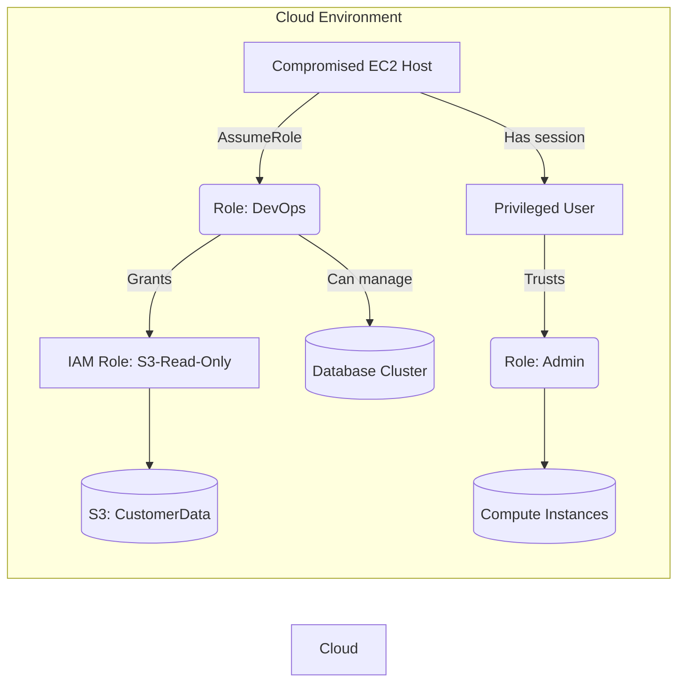
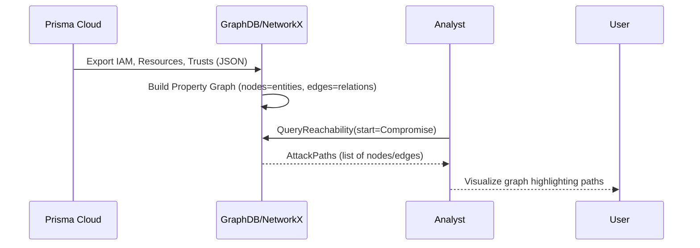
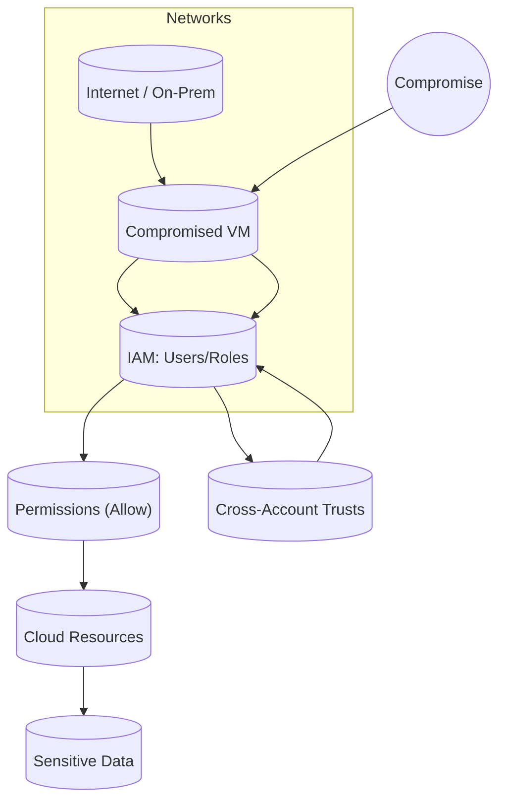

# Executive Summary  
Cloud environments pose **complex breach scenarios**: a single compromised host can leverage misconfigured IAM, network trust, and vulnerable resources to pivot across accounts and **escalate privileges**. Recent work (2023–2026) emphasizes pre-computing a **unified security graph** of the environment (resources as nodes; permissions, network links, data flows as edges) so that attack paths and *blast radius* (reachability) can be rapidly computed. For example, **Sola Security** (2026) describes an offline graph-building approach where identities, resources (VMs, buckets, databases), and relationships (policy grants, trust links, network reachability) are stored in a **typed property graph**. At query time, attack-vector “templates” (permission and network traversals) are executed on this graph to yield reachable assets. This contrasts with on-demand analysis (e.g. live API calls or LLM agents) and yields much higher coverage of multi-step paths (e.g. Sola’s system achieved ~0.55 recall vs ~0.30 for LLM-based tools).  

Recent research has explored **scaling and modeling** these analyses. An arXiv preprint (Nov 2025) applies *hypergraph semantics* to model “complex, multi-dimensional privilege relationships” across multi-cloud IAM, achieving sub-linear traversal complexity (≈O(√n)) by reifying user-role relationships as hyperedges. Other work has benchmarked “assumed-breach” queries (e.g. “which identities can read this bucket?”, “what resources does this compromised user reach?”) over real AWS estates, showing that purpose-built graph contexts drastically improve completeness and efficiency. Industry blogs and tools reinforce these ideas: SpecterOps’s open-source **AWSHound** (2026) builds an IAM-augmented “BloodHound” graph by offline policy evaluation (only creating edges where effective permissions allow actions). Vendors like Microsoft and Palo Alto have adopted similar graph-based *attack path analysis* in Defender for Cloud and Prisma Cloud, automatically correlating vulnerabilities, misconfigurations, and permissions into path visualizations.  

We survey the latest literature (papers, arXiv, talks, blogs, tools) on cloud attack-path and blast-radius analysis, focusing on scalability, data requirements, and novel methods. We then outline **POC projects** using Prisma Cloud’s telemetry (IAM roles/policies, network configs, flows, resource metadata) to construct and query such graphs. Each POC lists required data, analysis steps, expected outputs (e.g. reachable-asset graphs), limitations (e.g. policy conditions), and estimated effort/value. Finally, we identify gaps and unique directions beyond current CNAPP features (e.g. agentic AI integration, real-time path updates, cross-domain trust detection) and compare approaches in tables. 

## Attack Paths and Blast Radius in Cloud Security  
An **attack path** in a cloud context is a multi-step chain of exploits or misconfigurations an attacker can use to move from an initial foothold (e.g. a vulnerable VM) to sensitive assets (data, high-privilege roles, etc.). *Blast radius* refers to the scope of assets and data impacted when an attacker traverses that path. Modern attackers exploit *combinations* of issues (an exposed server **plus** an overly-broad IAM role **plus** a critical vulnerability, etc.) to amplify their reach. For instance, the Capital One breach (2019) was not just due to a misconfigured WAF but to the blast radius unlocked when that WAF used an over-privileged IAM role to access customer data.  

Traditional CSPM tools flag individual misconfigurations, but cannot easily **see cross-cloud paths**. As CSA explains, cloud breaches often cost the most when “an attacker reached further than the defender could see”. In practice, this means a defender needs *graph-based* correlation: e.g. linking an exposed EC2 (entry point) to which IAM roles it has, which roles trust each other, and which data those roles can access. Industry analysts emphasize that modern CNAPPs must not just list alerts, but *understand relationships*: “security teams can reason about exposure across the environment rather than each asset in isolation”. Attack-path analysis computes these transitive relationships automatically, generating a visual graph from the compromised node to all reachable sensitive resources.  

**Key Points:**
- Cloud attack paths combine **network exposure, identity entitlements, and service vulnerabilities**. (E.g. internet-facing VM → leaked credentials → assume privileged role → access DB.)  
- Effective analysis requires a *unified model* of the cloud estate (identities, resources, permissions, network links) to answer queries like “which principals can reach this S3 bucket?” across accounts.  
- Pre-computing a contextual graph (or hypergraph) enables **fast, repeatable queries** about reachability and privilege flows, instead of ad-hoc API calls or manual investigations.  

*Figure: Example cloud attack path graph (mermaid). A compromised host (A) leads to traversal through roles and trust relationships to access resources (D, E, H).*  

## Recent Research and Industry Reports (2023–2026)  

**Sola Security (2026, arXiv):** Introduced the concept of a *security knowledge graph* for cloud estates. Resources (VMs, storage, etc.) and identities are nodes; relations (IAM grants, trust, network reachability) are edges. Attack patterns (e.g. “AssumeRole traversal”) are executable on this graph. In experiments on real AWS accounts, this approach dramatically outperformed general AI agents: the graph-based system covered ~55% of known findings vs ~28–34% by AI scripts, at ~20–40× lower cost. Key strengths: **full context assembly offline** (identity reconciliation, inferring hierarchical grants, cross-account links), leading to fast, accurate incident scoping. The paper provides a rigorous evaluation framework (blinded recall, cost metrics).

**Hypergraph Privilege Analysis (2025, arXiv alphaXiv):** Sitharaman *et al.* (Nov 2025) address multi-cloud IAM at big-data scale. They embed NIST NGAC policies in a labeled *hypergraph*, modeling complex attribute relationships. This achieves sub-linear traversal (≈O(√n)) for privilege-path detection, validated on AWS systems with up to 4000 users, reporting 10× speedup over ABAC and 4× over standard NGAC-DAG approaches. They introduce a 3D framework (Attack Surface, Attack Window, Attack Identity) to systematize risk. This work is significant for large enterprises needing **real-time analysis** of thousands of entitlements.

**Graph-Based Cloud ASM (CloudMatos blog, 2025):** A recent industry article outlines "Graph-Based Attack Path Analysis" for cloud attack surface management. It describes modeling infrastructure assets, identity entitlements, and data stores in a unified graph to reveal multi-step lateral movements (e.g. chaining low-severity issues into full exploits). While not academic, it reflects common practice: building a graph and then using it to separate *theoretical* (unreachable) vulnerabilities from *validated* exposures by combining network visibility and container configs. This underscores the value of **attack-path-aware vulnerability scoring** (vulnerabilities are only critical if reachable via the graph).

**Attack-Path Features in Leading Platforms:** Vendor blogs and documentation reveal that major CSPM/CNAPP tools now include attack-path analysis. Microsoft’s Defender for Cloud, for example, “uses graph-based security analysis to identify exploitable relationships” linking internet-facing VMs, vulnerable workloads, and identities to sensitive resources. Palo Alto’s Prisma Cloud (industry analysis) now has an “Application Graph” that correlates code-base vulnerabilities, IaC misconfigurations, and orchestration state: “graph database technology…[correlates] disparate signals… to pinpoint risks and understand the breach pathways to critical assets”. Orca Security similarly defines attack path analysis as automatically identifying “risk combinations” across clouds and visualizing them as interactive graphs, scoring each path by business impact.

**Open-Source Tools:** Several new open-source projects embody these ideas:
- *AWSHound* (SpecterOps, 2026) is a Python tool that **collects AWS inventory into a BloodHound graph**. It performs an **offline IAM policy evaluation** (including SCPs and boundaries) before creating edges, ensuring only *effective Allow relationships* are added. The result is a Neo4j-compatible OpenGraph of principals and resources, enabling standard path-finding queries across multiple AWS accounts.
- *ZeroX IAMScope* (2024, GitHub) is a rule-based analyzer for AWS IAM. It ingests a snapshot of IAM policy documents and resource metadata, then detects “multi-hop role assumption reaching a role with a detected escalation path” (among other dangers like wildcard principals). While not truly graph-search, its multi-hop rule shows the necessity of reasoning about chained permissions.  
- *DataDog Pathfinding Labs* (2023) provides *attack scenario infrastructures* for training (Intentional vulnerable AWS multi-account labs), not an analysis engine, but illustrates typical cloud attack vectors.  

**Graph Algorithms and Scalability:** Large clouds imply massive graphs (millions of nodes). Recent works employ advanced data structures to cope:
- **Hypergraphs** (as above) reduce complexity of multi-dimensional policies.
- **Property graphs with indices**: Tools use graph DBs (Neo4j, TigerGraph, Amazon Neptune) to store and query relationships. Graph DB indexing enables sub-second reachability checks on >100k nodes.
- **Incremental/streaming updates**: While research is sparse, production systems often continuously ingest telemetry (config changes, logs) into the graph. Several references note that **maintaining a live blast-radius metric** requires continuous updating (CSA recommendation).  
- **Heuristics**: To prune search space, systems may limit traversal depth, drop edges deemed low-risk (e.g. disabled roles), or focus on prioritized assets (crown jewels) with scores.  
- **Machine learning**: Not much in open literature yet, but some proposals suggest using ML for *predictive prioritization* of likely attack paths or scoring edges by exploitability (e.g. Crowdstike “predictive path analysis”).  

| **Source/Tool**                        | **Year** | **Cloud**      | **Approach**                      | **Pros**                                     | **Cons**                                 | **Reproducible?**      |
|----------------------------------------|----------|----------------|-----------------------------------|----------------------------------------------|------------------------------------------|------------------------|
| *Sitharaman et al.: Hypergraph IAM*    | 2025     | AWS/GCP (multi)| Hypergraph NIST NGAC; complexity O(√n) | Efficient at large scale; supports complex policies | Publication only (no code shown)         | N/A (preprint)         |
| *Goldberg et al.: Sola Security Brain* | 2026     | Multi-cloud    | Security knowledge graph (Neo4j-like)  | High coverage; fast query time; cost-effective  | Proprietary; agent focus               | N/A (vendor research)  |
| **AWSHound** (open-source)       | 2026     | AWS            | BloodHound graph (offline IAM eval)      | Open-source; accurate effective-perm graph    | Limited to AWS; condition handling complex | Yes (GitHub repo)      |
| **ZeroX IAMScope** (open-source) | 2024     | AWS            | Static rule-based IAM analysis         | Evidence-backed findings; multi-hop rules   | Not full graph traversal; test-based    | Yes (GitHub repo)      |
| **CloudMatos ASM** (blog)            | 2025     | Multi-cloud    | Cloud ASM platform (graph-based model) | Highlights chaining vulnerabilities         | Marketing blog (no data)               | N/A (vendor blog)      |
| **ProArch Azure Attack Path** (blog) | 2026     | Azure          | Defender-for-Cloud graph analysis      | Practical examples; vendor insight         | No data, conceptual                     | N/A (vendor blog)      |
| *NIST Wang et al.: Probabilistic metric* | 2008     | Networks       | Attack-graph probabilistic metric      | Seminal formal model; heuristics for cycles | Pre-cloud era; computationally heavy    | Paper (algorithmic)    |

*Table: Summary of recent work and tools for cloud attack-path/blast-radius analysis. “Approach” describes method; “Reproducible” indicates if implementations or data are publicly available.*  

## Data Requirements: Prisma Cloud Telemetry  
To build an attack graph from **Prisma Cloud** data, one would extract all relevant inventory and configuration objects via its APIs or exports. Key data types include: 

- **Identity Data (IAM)**: All users, groups, roles, service principals, and attached policies. For each role/user, retrieve inline and managed policies, trust policies (for role assumption), permission boundaries, and AWS Organizations SCPs. Crucial fields: policy statements (actions, resources, conditions), role ARNs, account IDs, session policies. Cross-account trust links (role trust in another account) should be captured.

- **Resource Inventory**: List of cloud resources (EC2, S3, RDS, VMs, storage accounts, clusters, etc.), with attributes like resource ID/ARN, region, tags (environment, classification), and config details (e.g. S3 public flag, encryption enabled). From Prisma: use its Inventory API (e.g. `/api/v2/cloud/inventory`).

- **Network Topology**: VPCs, subnets, security groups, NACLs, load balancers, and connectivity (VPC peering, Transit Gateway attachments). Fields: SG rules (protocol/port/CIDR), route tables, peering IDs. **Network Flow Logs** (if available from Prisma) can enrich edges (e.g. observed traffic from subnet A to B).

- **Service Config & Telemetry**: E.g. S3 bucket policies, KMS key policies, database security groups, Identity Provider trust configs. Also **CloudTrail/Activity logs** of IAM actions (optional) to infer actual usage patterns. Prisma may supply findings like "privileged role assigned to public compute" that can seed the graph.

- **Contextual Metadata**: Business-criticality or sensitivity labels (e.g. “production DB”), vulnerability scan results (CVEs on workloads), compliance findings. This is used for scoring, not necessarily graph structure.

In practice, one would call Prisma’s REST API (e.g. Cloud API endpoints) or export its data to a JSON or graph DB. The schema is vendor-specific, but key fields to collect are **ARNs/IDs of principals and resources, and the full statements of IAM and resource policies**. The graph-building code must parse those policies and create directed edges (e.g. an edge Role→Bucket if the role’s policy allows `s3:GetObject` on that bucket). Tools like AWSHound demonstrate extracting all principals and resources and evaluating “Allow” before adding edges.  

**Example Schema Fields:** (not exhaustive)  
- *Principals:* `{ "Type": "Role", "ID": "arn:aws:iam::123:role/DevOps", "Policies": [...], "Trusts": [...] }`  
- *Resources:* `{ "Type": "S3", "ID": "arn:aws:s3:::customer-data", "Public": false, "Encrypted": true }`  
- *Network:* `{ "Type": "SecurityGroup", "ID": "sg-0abc", "IngressRules": [...], "EgressRules": [...] }`  
- *Flows:* `{ "SrcIP": "10.0.0.5", "DstIP": "10.0.1.7", "Port": 22, "Allowed": true }`.  

Once data is collected, construct a graph (e.g. NetworkX or Neo4j). Nodes = principals, resources, networks. Edges = **IAM Grants** (Role A “can do” Action X on Resource B), **Trusts** (Role → Role across account), **Network** (Subnet→Subnet if routing permits), **Dataflows** (optional). Pre-compute “effective permissions” by intersecting identity and resource policies (as AWSHound does) to avoid spurious edges.

## Evaluation Metrics and Benchmarks  
Research uses metrics beyond mere graph size or running time. Notable measures include:  

- **Coverage/Recall:** Fraction of true exposures or paths found by the analysis. Sola et al. use *pooled relative recall* (blinded merge of all system outputs) to assess how much of the potential risk surface is surfaced. They showed the graph-based brain covered ~55% vs ~28% for LLMs on the same tasks. In smaller benchmarks, one might measure “percentage of known privilege escalation chains detected.”  

- **Cost & Efficiency:** Time and computation cost per query or per resource. Sola normalized cost by model size and API usage; hypergraph work reports big-O improvements. For large clouds, wall-clock time and memory of path queries are critical.  

- **Blast Radius Size:** Post-simulation, measure # of compromised resources reachable from a point of compromise. Compare “pre- and post- scenario” breadth. (No standard metric here, but could count number of high-severity nodes reachable.)  

- **Attack Path Count:** Number of distinct multi-hop paths found (potentially enormous). Some approaches limit to “top N risky paths” scored by severity.  

- **Precision (False Positives):** If policy conditions uncertain, static graph may include impossible paths. Some works note a trade-off: AWSHound “leans toward attacker” on unknown conditions, meaning it errs by including paths (safe since better detect than miss). Precision can be scored by manual verification or by log-based replay.  

- **Benchmarks/Scenarios:** Few public datasets exist. Researchers often generate synthetic multi-account scenarios or use sanitized real estates. The DataDog Pathfinding Labs (open source) provides deployable multi-account setups with known exploit chains, useful for testing tools and demonstration.  

## Proof-of-Concept (POC) Ideas using Prisma Data  
Below are illustrative POC projects that leverage Prisma Cloud telemetry to perform assumed-breach or blast-radius analysis. Each assumes access to Prisma’s API data (via Python SDK or REST) and standard graph or scripting tools. Effort estimates are rough (e.g. person-weeks). 

- **POC 1: Single-Account Attack Path Finder.**  
  - *Data Required:* Inventory of IAM roles/users and policies, resource list (buckets, VMs, databases), and network config (VPC/subnets, SGs) from Prisma. An example AWS JSON snapshot.  
  - *Steps:*  
    1. **Collect and Normalize:** Use Prisma Cloud API (or AWS APIs via Prisma integration) to pull IAM and resource metadata into JSON. Filter for the relevant account.  
    2. **Build Graph:** In Python (NetworkX or similar), create nodes for each principal and resource. Add edges:  
       - **IAM edges:** If Principal P’s policies (plus trust and SCPs) allow Action X on Resource R, add P→R. (Reuse logic from AWSHound for policy simulation.)  
       - **Trust edges:** For cross-account roles P→R if P can assume R (trust policy).  
       - **Network edges:** If two subnets or VPCs are peered or reachable, connect accordingly. Also if Principal P has network path to machine M, link them (e.g. security group allows P’s traffic).  
    3. **Query Paths:** Mark a compromised host node H. Use BFS or Dijkstra (if weighting edges by criticality) to enumerate reachable assets (roles, data) within, say, 3 hops. Record all distinct paths.  
    4. **Visualize:** Output a subgraph (e.g. in Graphviz or mermaid) showing H→Role→Resource paths. Flag high-severity targets (tag “production” or containing sensitive data).  
  - *Expected Output:* A list and diagram of attack paths from H to data/privileged roles. Example: “H → RoleA → S3:CustomerData (read) → → [CrownJewelBucket]”.  
  - *Limitations:* Static analysis cannot account for conditional policies fully; may over-estimate risk. Doesn’t include live telemetry (e.g. MFA use). Only as good as latest config snapshot.  
  - *Effort & Value:* ~1 week to prototype with Python/NetworkX. Value: immediately shows critical exposures from a host (useful for incident response).

- **POC 2: Cross-Account Blast Radius Graph.**  
  - *Data Required:* As above, but include **all accounts** in an organization (Prisma’s multi-account inventory). Cross-account trust (IAM roles, Org policies) is crucial.  
  - *Steps:*  
    1. **Aggregate Data:** Pull IAM and resource lists for each account. Include links: e.g. AWS Organizations OU membership, cross-account roles.  
    2. **Build Global Graph:** Same as POC 1 but nodes carry account ID. Edges include cross-account assume-role and network (Transit Gateways, etc.).  
    3. **Simulate Breach:** Pick a node (e.g. compromised on-prem AD user or AWS role). Perform traversal across the graph.  
    4. **Report Blast Radius:** Count reachable accounts/resources. Possibly color nodes by account.  
  - *Expected Output:* A multi-account graph. E.g. “Compromise in Account A allows assuming RoleX → reaches Database in Account B and S3 in Account C.” Possibly export to a Neo4j instance and use its visualization.  
  - *Limitations:* Complexity increases fast with accounts and roles. May need heuristics (e.g. stop after crossing trust boundary twice).  
  - *Effort & Value:* ~2 weeks (more data wrangling). High value for enterprises to see cross-account impact (often blind to chained compromise).

- **POC 3: Vulnerability-Weighted Path Scoring.**  
  - *Data Required:* Same as POC1 plus vulnerability scan output (e.g. AMI CVEs, container image CVEs) from Prisma, and network exposure tags.  
  - *Steps:*  
    1. Use the graph from POC1. For each edge/node, attach a weight based on exploitability (e.g. CVSS score if resource is unpatched).  
    2. Compute “most dangerous paths”: find top-N shortest (highest-sum) paths from a compromised point to high-value assets. Techniques like Yen’s K-shortest paths on weighted graph.  
    3. Present findings: “If H is breached, the *highest-risk path* to production DB is: H → (Server1, unpatched RCE) → DevRole → ProdDB (write), cumulative risk=8.4.”  
  - *Outputs:* Ranked list of attack chains with risk scores. Possibly a dashboard highlighting “toxic chains” (e.g. Admin role + public S3).  
  - *Limitations:* Weighting is heuristic; real exploit probability is complex. Also dynamic conditions (MFA, context) ignored.  
  - *Effort & Value:* ~2-3 weeks. Great for risk prioritization and illustrating “toxic combinations” as CSA suggests.

*Figure: Data pipeline for attack-path analysis: Prisma Cloud exports configuration data, which is loaded into a graph structure. Analysts query the graph (e.g. via BFS) to find reachable assets, then visualize or report the results.*  

## Novel Directions and Beyond Existing Products  
Beyond the baseline graph analysis, several emerging ideas could add value: 

- **Agentic AI for Incident Playbooks:** As seen in recent studies, combining the graph context with LLMs can help generate remediation steps or refine queries. (E.g. ask an LLM given the attack graph to write an “investigation plan”.)  

- **Real-time Blast Radius Monitoring:** Continuously update the graph with streaming telemetry (CloudTrail, flow logs) to track change in blast radius over time. Alert if a critical path suddenly opens (e.g. a new trust or vulnerability). CSA recommends treating blast radius as a “live signal”.  

- **Probabilistic Path Metrics:** Classical research (NIST 2008) computes probabilities of multi-step exploits. In cloud context, one could extend this by assigning exploit likelihoods to edges and computing overall compromise probability. This could help quantify “most likely” attack paths given known threat models.  

- **Cross-Domain Integration:** Incorporate on-prem identity (Active Directory trusts, VPN links) and SaaS entitlements into the graph, achieving true hybrid blast-radius scoping (as CSA notes).  

- **ATT&CK Mapping:** Tag edges/nodes with MITRE ATT&CK tactics to automatically generate “threat stories” and map discovered paths to techniques, streamlining SOC workflows (as CSA scenario did).  

- **Graph Red Teaming:** Use adversarial search on the graph to identify “choke points”: e.g. which single removal of a permission or role attachment would disconnect the most attack paths? This is akin to computing minimum cutsets for privilege graphs.  

- **Scalable Databases:** Implement the knowledge graph in distributed graph engines (e.g. Amazon Neptune, TigerGraph) to handle enterprise scale (millions of nodes). Query optimizations like materialized views for high-traffic assets (e.g. precompute reachability from key identities).  

- **Value Proposition:** Each POC above yields distinct business value: (1) faster incident scope analysis (reduce downtime), (2) preventive risk assessment (shrink blast radius), (3) prioritized remediation (focus on critical chains). Effort varies: basic graph POCs can be built with existing data in weeks; production-grade solutions need more integration. Overall, organizations that invest in assumed-breach graph analysis can dramatically cut breach costs by **containing incidents faster** (CSA cites ~$1M+ savings when breaching is contained early).

## Tables Comparing Approaches and Tools  

| **Approach/Tool** | **Year** | **Cloud Env.** | **Method**                           | **Scale Tested**                | **Pros**                                     | **Cons**                                     |
|-------------------|----------|----------------|--------------------------------------|---------------------------------|----------------------------------------------|----------------------------------------------|
| Sola Security Brain     | 2026     | AWS/Azure/GCP | Offline knowledge graph + query logic  | Thousands of resources, multi-tenant | High coverage; fast query; cross-vendor    | Proprietary; requires building large graph    |
| Hypergraph IAM            | 2025     | AWS/GCP        | NIST NGAC in hypergraph (O(√n) traversals) | 200–4000 users (AWS validation) | Scalable analysis; formal proof of efficiency | Focused on IAM; complexity for operators    |
| AWSHound                   | 2026     | AWS            | Python tool → BloodHound OpenGraph dataset | Single account to Org-level (∞) | Open-source; robust IAM evaluation          | AWS-only; partial support for conditions     |
| ZeroX IAMScope             | 2024     | AWS            | Static analyzer with evidence rules       | Offline JSON snapshots (test fixtures) | Rules are explainable; finds multi-hop paths | Coverage limited to pre-coded rules; new findings need code |
| Microsoft Defender (via ProArch)| 2026 | Azure         | Graph-based path analysis (built into portal) | Enterprise Azure customers         | Integrated in Defender UI; auto detection   | Azure-only; details proprietary              |
| Prisma Cloud Attack Graph   | 2023     | AWS/Azure/GCP | Graph DB correlating code, IaC, cloud state | Not disclosed (enterprise scale) | Unified pipeline-to-production view         | Vendor locked; no public docs               |
| DataDog Pathfinding (Labs)       | 2023     | AWS (labs)     | Deployable attack scenarios (no analytics)   | Custom multi-account setups       | Great for training; realistic multi-hop paths| Not an analysis tool (no automated path scoring) |
| Traditional Attack Graph (MulVAL) | 2014     | Network infra  | Logic-based vulnerability graph            | Small networks                    | Formal logic reasoning                       | Not cloud-aware; O(nodes^3) cost            |

*Figure: Conceptual attack path graph: edges represent IAM grants, trust relationships, and network connectivity. A threat (Compromise) entering at a VM can propagate via these edges to other identities (IAM) and ultimately to data resources.*  

